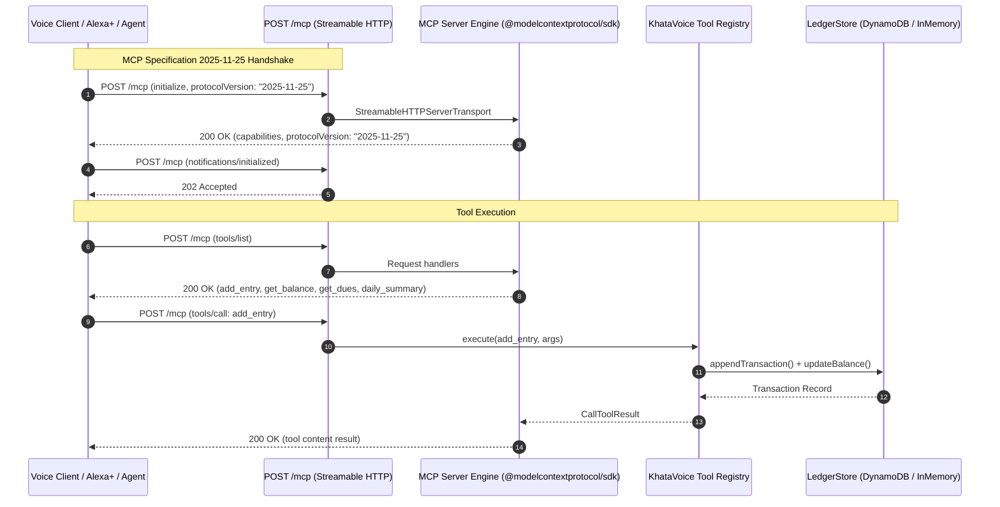

# KhataVoice Architecture Document

## Overview
KhataVoice is a production-grade, voice-first Model Context Protocol (MCP) server designed for small-business financial ledger operations. It enables small shop owners (*kirana* stores, artisans, traders) to conduct bookkeeping—recording credit (*udhaar*) and debit (*jama*), looking up balances, querying overdue debts, and generating end-of-day reconciliation summaries—entirely through voice.

## Protocol Specification & Transport
- **Specification Version**: MCP `2025-11-25`
- **Transport**: Canonical **Streamable HTTP** (`POST /mcp`) via official `@modelcontextprotocol/sdk` (`StreamableHTTPServerTransport` / `WebStandardStreamableHTTPServerTransport`).
- **Session Architecture**: **Stateless Streamable HTTP**. Financial state resides strictly in the `LedgerStore` / DynamoDB layer—never in transport session memory. This guarantees frictionless AWS Lambda scaling without sticky routing.
- **Endpoints**:
  - `POST /mcp`: **Canonical MCP Endpoint**. Handles JSON-RPC 2.0 messages (`initialize`, `notifications/initialized`, `tools/list`, `tools/call`, `ping`). Returns `application/json` (or `text/event-stream` if streaming negotiated).
  - `GET /mcp`: Optional Streamable HTTP SSE stream endpoint.
  - `DELETE /mcp`: Session termination handler.
  - `GET /mcp/sse` & `POST /mcp/message`: *LEGACY SSE COMPATIBILITY* (retained temporarily as fallback routes; not the primary architecture).

### Streamable HTTP Architecture Diagram

## Core MCP Tools
1. `add_entry`: Records financial ledger transactions (credit/debit) with counterparty name, amount, optional phone number, description, and optional `idempotency_key` / `client_request_id` guaranteeing at-most-once mutation.
2. `get_balance`: Calculates the outstanding balance for a specific customer or store-wide ledger total.
3. `get_dues`: Returns a ranked list of debtors with outstanding balances, supporting minimum threshold filters.
4. `daily_summary`: Generates closing daily financial metrics (total cash received, total credit extended, net cash movement, transaction volume).

## Idempotency Architecture
- **24-Hour Deduplication Policy**: Each `add_entry` request can supply an `idempotency_key` or `client_request_id`.
- **Atomic DynamoDB Enforcement**: Writes an `IDEMP#<customerSlug>#<key>` item inside the `TransactWriteItems` batch protected by `ConditionExpression: attribute_not_exists(PK)` with a 24-hour TTL. If an identical key is presented, DynamoDB rejects the transaction atomically with `TransactionCanceledException (ConditionalCheckFailed)`. The server catches this, loads the prior transaction and balance, and returns `isDuplicate: true` with zero balance mutation.
- **InMemoryStore Concurrency Lock**: In-flight concurrent request promises and a 24-hour cache guarantee that duplicate parallel calls execute exactly once.

## Security & Authentication Architecture
- **Production Mode**: When `NODE_ENV=production` or `MCP_API_KEY` is configured, all requests to `/mcp` require an `Authorization: Bearer <MCP_API_KEY>` header. Missing or invalid keys return HTTP 401 with standard JSON-RPC error `-32000`.
- **Local Dev Mode**: In development/local mode with no key configured, zero-credential evaluation is permitted.
- **Credential Protection**: API keys are never logged and never exposed in browser client builds.
- **Network Defenses**: Host header validation blocks DNS rebinding attacks, and CORS restricts access to explicit simulator origins.

## Storage Architecture
KhataVoice uses a pluggable Repository Pattern:
- **`InMemoryStore`**: Pure TypeScript in-memory store for local development, zero-credential evaluations, and offline testing. Pre-seeded with authentic merchant sample data.
- **`DynamoDBStore`**: Single-table design for AWS production on Amazon DynamoDB with ACID transactional guarantees via `TransactWriteItems`.

## Cloud Stack
- **Amazon Bedrock**: Converse API tool-calling engine powered by Claude 3.5 Sonnet / Claude 3 Haiku or Amazon Nova.
- **AWS Lambda**: Node.js 20.x serverless function utilizing Lambda Function URLs with Response Streaming (`RESPONSE_STREAM`).
- **Amazon DynamoDB**: On-Demand single-table store (`KhataVoiceTable`).

## Voice Demo Client
A React + Vite web application serving as the evaluation interface. It provides:
- Live audio waveform and Web Speech recognition (English & Hindi/Hinglish).
- Real-time Ledger table.
- Collections Copilot card with Top 3 priority debtor recommendations.
- Overdue debts leaderboard with one-click WhatsApp payment reminders.
- An interactive **MCP Inspector** showcasing real-time JSON-RPC 2.0 requests and SSE frames.

## Phase 2: Collections Copilot Architecture
The Collections Copilot is an autonomous reasoning feature that answers natural merchant collection questions (e.g., *"Aaj kin logon se paise lene chahiye?"* or *"Who should I collect money from today?"*).

The Copilot invokes 3 real production MCP tools:
1. **`get_dues`** (Arguments: `{ merchant_id, limit: 10 }`):
   - Retrieves active debtors who have positive net debt (`netBalance > 0`), including debtor names, contact numbers, exact amounts owed, last transaction dates, and overdue days pending.
   - **Why invoked**: Provides the primary candidate pool of debtors to be evaluated for collection priority.
2. **`daily_summary`** (Arguments: `{ merchant_id }`):
   - Calculates today's cash velocity, total credit extended, total payments received, and net cash flow across the store.
   - **Why invoked**: Contextualizes today's cash position to evaluate overall store collection urgency.
3. **`get_balance`** (Arguments: `{ merchant_id }` — `customer_name` omitted):
   - When `customer_name` is omitted, `get_balance` runs in **store-wide aggregation mode** (`isStoreWide: true`), calculating aggregate store receivables (`totalDebit`), payables (`totalCredit`), and net overall balance across all customer accounts.
   - **Why invoked**: Verifies store-wide ledger balance integrity and ensures total outstanding calculations reconcile accurately across the entire ledger.

